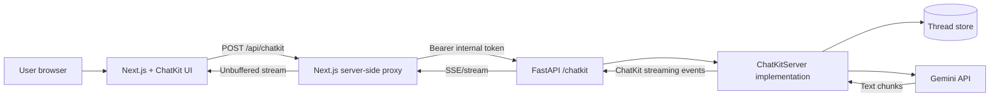

# OpenAI ChatKit + Gemini Chatbot

## All-in-One Build, Troubleshooting, Best-Practices, and Verification Guide

**Audit date:** 2026-10-17  
**Workspace audited:** `C:\Users\dell\Documents\Codex\2026-10-16\hi`  
**Intended application:** Next.js frontend using OpenAI ChatKit with a Python/FastAPI backend that calls Gemini 3.6 Flash

> [!IMPORTANT]
> This document separates facts into three categories: **verified now**, **historical session claim**, and **recommended implementation**. The application source code is not currently present in the audited workspace, so this document does not claim that the earlier build is complete or deployable.

---

## 1. Executive Summary

The intended product is a chatbot with the following request path:

```text
Browser
  -> Next.js application
  -> Next.js /api/chatkit proxy
  -> Python FastAPI /chatkit endpoint
  -> Gemini API
  -> streamed ChatKit protocol events
  -> official ChatKit user interface
```

The architecture is valid in principle. OpenAI's official documentation supports an advanced, self-hosted ChatKit integration in which a custom server implements the ChatKit protocol, handles incoming requests, and streams events to the client. Google currently documents `gemini-3.6-flash` as a stable Gemini model.

However, the current workspace audit found that the source directory and source ZIP described in the earlier session summary are missing. Therefore:

- The Next.js source cannot currently be inspected.
- The Python/FastAPI source cannot currently be inspected.
- `package.json`, `pnpm-lock.yaml`, and Python dependency manifests cannot currently be inspected.
- Type checking, linting, builds, backend tests, and live chat tests cannot currently be rerun.
- The earlier claim that the project and ZIP are available under `outputs` is no longer correct.
- The project must be restored from GitHub or another backup before deployment verification.

Two UI screenshots are still present. They prove that a Northstar interface was rendered at some point, but they do not prove that ChatKit or Gemini worked end to end.

---

## 2. Evidence and Audit Method

The audit checked the filesystem directly instead of relying only on the previous summary. It included:

- Recursive searches for the expected TypeScript and Python source files.
- Searches for the expected project directory, source ZIP, package manifest, and preview image.
- Inspection of the existing Markdown session summary.
- Inspection of the extracted Python ChatKit wheel metadata.
- Inspection of cached npm registry metadata for `@openai/chatkit-react`.
- Runtime version checks for Node.js, pnpm, and Python.
- Visual inspection of the remaining desktop and mobile screenshots.
- Current official documentation checks for ChatKit, Gemini 3.6 Flash, and Vercel deployment behavior.

No real secrets were read or copied during this audit.

---

## 3. Current Workspace Inventory

### 3.1 Verified files that exist

| Artifact | Verified location | What it proves |
|---|---|---|
| Earlier session summary | `outputs/SESSION_SUMMARY.md` | Records earlier claims, but does not prove the source still exists |
| Python ChatKit wheel | `work/openai_chatkit-1.6.5-py3-none-any.whl` | Confirms a local copy of the `openai-chatkit` 1.6.5 package artifact |
| Extracted Python package metadata | `work/openai-chatkit-package/openai_chatkit-1.6.5.dist-info/METADATA` | Confirms package name, version 1.6.5, Python requirement `>=3.10`, and declared dependencies |
| Desktop UI screenshot | `work/northstar-final.png` | Confirms a desktop Northstar setup-state UI rendered |
| Mobile UI screenshot | `work/northstar-mobile.png` | Confirms a mobile render was attempted; it also reveals horizontal clipping |
| npm registry cache metadata | `work/pnpm-cache/pnpm/v11/metadata/registry.npmjs.org/@openai/chatkit-react.jsonl` | Confirms that `@openai/chatkit-react` 1.6.1 existed in the cached registry metadata; it does not prove installation in the missing project |

### 3.2 Verified runtime versions in the current environment

```text
Node.js: v24.20.0
pnpm:    11.25.0
Python:  3.14.7
```

These are the current machine runtimes, not proof of the versions used by the missing application source.

### 3.3 SHA-256 hashes of key surviving artifacts

```text
outputs/SESSION_SUMMARY.md
38F33C898590763B42EAFB62BE86150C4AC77452E64DE5B7E70CB59C137AC31F

work/openai_chatkit-1.6.5-py3-none-any.whl
9E16D3BDC6C15FEC900801591DC5BB8BA9446447D3DB2247DC8120518F1CA3C0

work/northstar-final.png
FA24FEFAD1FBD7173A042FA0575B89B6408B624B18069CDF2F6EA7902D9C8971

work/northstar-mobile.png
71A42153AE9AB2D1DD7F2597F600C7069FA201B044CD1BEE1FB1CDBF0DECD9FA
```

### 3.4 Expected artifacts that are missing

The following paths referenced by the earlier summary do not exist in the current workspace:

```text
outputs/chatkit-gemini/
outputs/chatkit-gemini-source.zip
outputs/northstar-chat-ui-preview.png
```

The expected individual source files also could not be found:

```text
src/components/chatkit-panel.tsx
src/components/chat-workspace.tsx
src/app/api/chatkit/route.ts
server/gemini_agent.py
server/chatkit_server.py
server/store.py
server/app.py
package.json
pnpm-lock.yaml
```

There is also no Git repository at the audited workspace root.

---

## 4. Audit of Earlier Session Claims

| Earlier claim | Current evidence | Verdict |
|---|---|---|
| Project exists in `outputs/chatkit-gemini` | Directory is absent | **Not currently true** |
| Source ZIP exists in `outputs` | ZIP is absent | **Not currently true** |
| Preview exists as `outputs/northstar-chat-ui-preview.png` | That file is absent; alternative screenshots exist under `work` | **Path is incorrect now** |
| `openai-chatkit==1.6.5` was used | Wheel and extracted metadata for 1.6.5 exist | **Artifact verified; project usage not verifiable** |
| `@openai/chatkit-react` 1.6.1 was used | Registry metadata is cached, but project manifest is missing | **Package version existed; installation not verifiable** |
| Next.js 16.4.1, React 19.3.1, TypeScript 6.0.3 were used | No `package.json` or lockfile exists | **Not verifiable** |
| `google-genai==2.31.0` was used | No requirements or lock file exists | **Not verifiable** |
| Lint, typecheck, and build passed | Source and scripts are absent, so checks cannot be rerun | **Historical claim only** |
| FastAPI health/auth/stream tests passed | Backend source and tests are absent | **Historical claim only** |
| Live Gemini conversation worked | Earlier summary explicitly said it was not tested | **Not verified** |
| ChatKit domain key is required for this custom integration | Current advanced-integration documentation does not list a domain key in its options reference | **Must be rechecked against the restored SDK code and current account configuration** |

The safe conclusion is that the earlier summary is useful as a design record, but it is not a substitute for the missing repository.

---

## 5. Intended Architecture



### 5.1 Frontend responsibilities

- Load the official ChatKit interface.
- Configure its API URL to use `/api/chatkit`.
- Display new-thread prompts, messages, progress, and errors.
- Keep the Gemini API key out of browser code.
- Provide a responsive container with a real minimum height.
- Handle ChatKit lifecycle errors visibly and log safe diagnostics.

### 5.2 Next.js proxy responsibilities

- Accept ChatKit requests from the browser.
- Forward the raw request body and required content headers to FastAPI.
- Add the private `CHATKIT_INTERNAL_TOKEN` server-side.
- Stream the upstream response without buffering the entire body.
- Preserve status codes and content types.
- Apply timeouts, abort handling, and safe error mapping.

### 5.3 Python/FastAPI responsibilities

- Authenticate the internal proxy request.
- Pass the request body to a `ChatKitServer` implementation.
- Return JSON for non-streaming protocol operations.
- Return `text/event-stream` for streaming results.
- Load and save threads through a `Store` implementation.
- Translate user messages into Gemini input.
- Translate Gemini output chunks into valid ChatKit events.
- Enforce per-user thread authorization.

### 5.4 Gemini agent responsibilities

The Gemini layer should be an orchestrator rather than the UI itself. It should:

1. Receive normalized conversation history.
2. Apply a controlled system instruction.
3. Call the selected Gemini model.
4. Stream or return text safely.
5. Surface provider errors in a structured form.
6. Avoid logging API keys or sensitive conversation content.

### 5.5 Storage responsibilities

For development, an in-memory store is acceptable. For production, use durable storage because an in-memory store:

- Loses all conversations when the process restarts.
- Does not work reliably across multiple instances.
- Cannot guarantee that a user's next request reaches the same memory space.

OpenAI's official advanced ChatKit documentation recommends a durable store for production and suggests considering JSON blobs so schema evolution can be handled more easily.

---

## 6. How to Build the Chatbot Correctly

This section is a recommended reconstruction procedure. It is not a claim about the missing source.

### 6.1 Restore or create the repository

Preferred recovery path:

```bash
git clone <YOUR_GITHUB_REPOSITORY_URL> chatkit-gemini
cd chatkit-gemini
git status
git log -1 --oneline
```

If the repository already exists on GitHub, restore it instead of rebuilding from memory. Record the commit hash used for deployment.

If no repository or backup exists, create a clean project and commit each working stage.

### 6.2 Recommended project structure

```text
chatkit-gemini/
├── src/
│   ├── app/
│   │   ├── api/
│   │   │   └── chatkit/
│   │   │       └── route.ts
│   │   ├── layout.tsx
│   │   └── page.tsx
│   └── components/
│       ├── chatkit-panel.tsx
│       └── chat-workspace.tsx
├── server/
│   ├── __init__.py
│   ├── app.py
│   ├── chatkit_server.py
│   ├── gemini_agent.py
│   ├── store.py
│   ├── requirements.txt
│   └── .env.example
├── tests/
├── .env.example
├── .gitignore
├── package.json
├── pnpm-lock.yaml
├── next.config.ts
├── tsconfig.json
└── README.md
```

### 6.3 Frontend setup

Create a Next.js project and install ChatKit:

```bash
pnpm create next-app@latest chatkit-gemini --typescript --eslint --app --src-dir
cd chatkit-gemini
pnpm add @openai/chatkit-react
```

Then:

1. Add the official ChatKit browser script exactly as required by the installed package documentation.
2. Create a client component that initializes ChatKit.
3. Configure the ChatKit API endpoint as `/api/chatkit`.
4. Disable file attachments until a real `FileStore` and upload policy are implemented.
5. Add a visible loading state and a useful error state.
6. Mount ChatKit inside a container with an explicit height or minimum height.

Do not copy an old `useChatKit` configuration blindly. Inspect the types shipped with the installed version:

```bash
pnpm why @openai/chatkit-react
pnpm exec tsc --noEmit
```

The current official advanced ChatKit documentation guarantees the concept of an API URL, but wrapper property names can differ by SDK version. Treat TypeScript as the source of truth for the installed package.

### 6.4 Next.js proxy setup

The `/api/chatkit` route should:

1. Read `CHATKIT_SERVER_URL` and `CHATKIT_INTERNAL_TOKEN` only on the server.
2. Reject startup or requests when either value is missing.
3. Forward the incoming method, body, and content type.
4. Add `Authorization: Bearer <internal-token>` to the upstream request.
5. Return the upstream stream directly.
6. Forward the upstream `Content-Type` and status.
7. Avoid converting a streaming response to JSON or text first.
8. Abort the upstream request when the browser disconnects.

Conceptual flow:

```text
Browser body
  -> Next.js route
  -> fetch(CHATKIT_SERVER_URL, raw body + private Authorization header)
  -> return new Response(upstream.body, upstream status and content type)
```

### 6.5 Python backend setup

Create and activate a virtual environment, then install the backend dependencies:

```bash
python -m venv .venv

# Windows PowerShell
.venv\Scripts\Activate.ps1

python -m pip install --upgrade pip
python -m pip install fastapi uvicorn openai-chatkit google-genai python-dotenv
python -m pip freeze > server/requirements-lock.txt
```

The official ChatKit server pattern is:

1. Subclass `ChatKitServer`.
2. Override `respond(...)` to yield valid ChatKit events.
3. Implement the `Store` contract.
4. Call `server.process(request_body, context)` from FastAPI.
5. Return a `StreamingResponse` for streaming results.
6. Return JSON for non-streaming results.

The exact event classes and constructors must come from the installed `openai-chatkit` version. Do not invent event JSON manually if the SDK provides typed models.

### 6.6 Gemini integration

Google's documented Python client pattern is based on `from google import genai` and `client.models.generate_content(...)` or `generate_content_stream(...)`.

Use the requested stable model explicitly:

```dotenv
GEMINI_MODEL=gemini-3.6-flash
```

Recommended implementation rules:

- Initialize one reusable Gemini client per process instead of creating a client per token.
- Set request timeouts.
- Pass a bounded amount of conversation history.
- Preserve user/assistant role order.
- If streaming, ignore empty chunks safely.
- Handle blocked or empty provider responses explicitly.
- Map provider failures to a user-safe assistant error and a detailed server log.
- Do not expose raw provider exceptions to the browser.

### 6.7 Thread store

Implement all methods required by the installed `chatkit.store.Store` interface. At minimum, expect responsibilities for:

- Creating, loading, listing, and deleting threads.
- Loading thread items with correct ordering and pagination.
- Adding and updating items.
- Generating stable IDs.
- Enforcing ownership through request context.

Use memory only for local development. For production, use PostgreSQL or another durable store and include a user/tenant ownership key on every thread lookup.

### 6.8 File uploads

Keep uploads disabled until all of the following are implemented:

- A `FileStore` implementation.
- MIME-type allowlists.
- Size and count limits.
- Malware scanning when appropriate.
- Private object storage or signed URLs.
- Authorization for file preview and deletion.
- Cleanup for deleted or abandoned uploads.

---

## 7. Environment Variables and Credentials

### 7.1 Recommended frontend/Next.js variables

```dotenv
NEXT_PUBLIC_CHATKIT_API_URL=/api/chatkit
CHATKIT_SERVER_URL=http://127.0.0.1:8000/chatkit
CHATKIT_INTERNAL_TOKEN=replace_with_a_long_random_secret
```

Only variables intentionally exposed to browser JavaScript should start with `NEXT_PUBLIC_`.

### 7.2 Recommended Python backend variables

```dotenv
GEMINI_API_KEY=replace_with_your_real_gemini_key
GEMINI_MODEL=gemini-3.6-flash
CHATKIT_INTERNAL_TOKEN=replace_with_the_same_long_random_secret
```

Generate the internal token with:

```bash
python -c "import secrets; print(secrets.token_urlsafe(32))"
```

### 7.3 Meaning of each credential

| Variable | Source | Exposure | Purpose |
|---|---|---|---|
| `GEMINI_API_KEY` | Google AI Studio | Backend only | Authorizes calls to Gemini |
| `CHATKIT_INTERNAL_TOKEN` | Generated by the developer | Next.js server and Python server only | Authenticates the proxy to the backend |
| `NEXT_PUBLIC_CHATKIT_API_URL` | Application configuration | Browser-visible | Tells the ChatKit frontend which application endpoint to call |

### 7.4 Domain-key warning

The earlier session used this variable:

```dotenv
NEXT_PUBLIC_CHATKIT_DOMAIN_KEY=local-dev
```

The current official advanced ChatKit integration page lists `apiURL` as required, but its published options reference does not list a domain key. The current audit also cannot inspect the missing frontend code or installed package types.

Therefore:

- Do not assume `NEXT_PUBLIC_CHATKIT_DOMAIN_KEY` is required for the self-hosted/custom-server path.
- Do not assume `local-dev` is a valid production or development value.
- Restore the repository, inspect the installed `@openai/chatkit-react` types, and confirm current account requirements.
- If the SDK or OpenAI dashboard explicitly requires domain registration, follow that exact flow and document where the issued value came from.
- Never treat a public domain key as a replacement for user authentication or server authorization.

### 7.5 Secret-handling rules

- Never put `GEMINI_API_KEY` in a `NEXT_PUBLIC_*` variable.
- Never commit `.env.local`, `server/.env`, Vercel secrets, or backend-host secrets.
- Commit only `.env.example` files containing placeholders.
- Rotate a key immediately if it appears in Git history, screenshots, logs, or chat messages.
- Use different internal tokens for development, preview, and production.
- Restrict who can read production environment variables.

---

## 8. Local Development Procedure

After the source has been restored, use two terminals.

### Terminal 1: backend

```bash
.venv\Scripts\Activate.ps1
python -m uvicorn server.app:app --reload --host 127.0.0.1 --port 8000
```

### Terminal 2: frontend

```bash
pnpm install --frozen-lockfile
pnpm dev
```

Open:

```text
http://localhost:3000
```

### Minimum local checks

1. Backend health endpoint returns 200.
2. `/chatkit` rejects a missing or wrong internal bearer token.
3. The Next.js proxy can reach the backend.
4. The browser receives a streaming response rather than one delayed block.
5. A second user message contains or retrieves the expected conversation history.
6. Provider errors appear as safe UI errors.
7. Refresh behavior matches the chosen storage strategy.

---

## 9. Deployment Design

### 9.1 Frontend on Vercel

Deploy from the directory containing `package.json`. Do not guess the Vercel Root Directory.

- If `package.json` is in the GitHub repository root, leave Root Directory blank.
- If it is inside `chatkit-gemini/`, set Root Directory to `chatkit-gemini`.
- Leave the output directory at the Next.js default unless the restored project explicitly changes it.
- Use the package manager indicated by the committed lockfile.
- Add environment variables separately for Development, Preview, and Production.

Expected Vercel variables:

```dotenv
NEXT_PUBLIC_CHATKIT_API_URL=/api/chatkit
CHATKIT_SERVER_URL=https://your-backend.example.com/chatkit
CHATKIT_INTERNAL_TOKEN=your_production_internal_token
```

Add a domain-related public variable only if the restored SDK configuration demonstrably requires it.

### 9.2 Python backend

Deploy FastAPI on a platform that supports the required Python version and streaming HTTP responses. Example start command:

```bash
python -m uvicorn server.app:app --host 0.0.0.0 --port $PORT
```

Expected backend variables:

```dotenv
GEMINI_API_KEY=your_production_gemini_key
GEMINI_MODEL=gemini-3.6-flash
CHATKIT_INTERNAL_TOKEN=the_same_production_internal_token_used_by_nextjs
```

### 9.3 Streaming infrastructure checks

- Confirm that the host does not buffer server-sent events.
- Set the correct `Content-Type` for streams.
- Disable inappropriate CDN caching for chat responses.
- Send periodic progress or keepalive data only if the protocol permits it.
- Test cancellation when the browser tab closes.
- Ensure platform timeouts are longer than the maximum provider response time.

### 9.4 Production data storage

Before scaling beyond one backend instance:

- Replace the in-memory store.
- Add database migrations or JSON-schema versioning.
- Add tenant/user ownership checks.
- Define retention and deletion behavior.
- Back up the data store.
- Make item creation idempotent where retries can occur.

---

## 10. Issues Found and How to Handle Them

### Issue 1: Source code and ZIP are missing

**Evidence:** The documented source directory and ZIP do not exist, and searches found none of the expected source files.

**Impact:** No reliable build, test, security review, or deployment verification is possible.

**Handling:**

1. Restore the GitHub repository locally.
2. Record the repository URL, branch, and commit hash.
3. Confirm the expected file tree.
4. Rerun all checks.
5. Recreate the ZIP from the verified commit only if a ZIP is still needed.

### Issue 2: Earlier documentation overstates completion

**Evidence:** `SESSION_SUMMARY.md` says the project directory and ZIP are available, but both are absent.

**Impact:** A new session could incorrectly assume it can continue from local source.

**Handling:** Use this audit document as the current handoff. Treat the earlier summary as historical context only.

### Issue 3: Credentials were conceptually mixed together

**Evidence:** Earlier discussion treated a public ChatKit domain value and a private internal bearer token as two “keys,” even though they serve different purposes.

**Impact:** A developer may expose a secret or believe a public configuration value provides backend security.

**Handling:**

- Gemini API key: provider secret, backend only.
- Internal token: self-generated server-to-server secret.
- Public ChatKit configuration: browser-visible and not a replacement for authentication.
- Domain-key requirement: verify against the restored SDK and current official setup before using it.

### Issue 4: Desktop screenshot is a setup state, not a live chat proof

**Evidence:** The desktop screenshot visibly says configuration is needed and asks for a ChatKit domain key.

**Impact:** It proves visual rendering, not a functional ChatKit/Gemini conversation.

**Handling:** Capture a new verification set after restoration:

1. Empty new-thread state.
2. User message sent.
3. Streaming assistant response.
4. Completed assistant response.
5. Restored thread after refresh.
6. Provider-error state.

### Issue 5: Mobile layout clips content horizontally

**Evidence:** `work/northstar-mobile.png` shows the large hero heading and description extending past the right side of the viewport.

**Impact:** Mobile users cannot read all content and may encounter horizontal scrolling.

**Handling:**

- Use responsive `font-size` with `clamp(...)`.
- Add `max-width: 100%` to text containers.
- Avoid fixed pixel widths larger than the viewport.
- Add `min-width: 0` to shrinking grid/flex children.
- Use `overflow-wrap: anywhere` for long technical strings.
- Test at 320, 360, 375, 390, 414, and 768 CSS pixels.
- Do not hide a real layout bug with `overflow-x: hidden` until the overflowing element is fixed.

### Issue 6: Build and tests cannot be reproduced

**Evidence:** There is no package manifest, lockfile, backend source, or test suite in the current workspace.

**Impact:** Historical “passed” results cannot be trusted for a new deployment.

**Handling:** Restore the exact commit and rerun the verification matrix in this guide.

### Issue 7: No live end-to-end Gemini test was completed

**Evidence:** The earlier session summary explicitly says a real Gemini conversation was not tested.

**Impact:** Credentials, model access, provider response handling, and real streaming remain unproven.

**Handling:** Run a low-cost smoke test with real credentials after local mocked tests pass. Do not log the key or the full provider response.

### Issue 8: Split frontend/backend deployment adds failure points

**Typical symptoms:** 401, 404, 502, CORS errors, timeouts, or a response that arrives all at once.

**Handling:** Verify each hop independently:

```text
Browser -> Next.js proxy -> FastAPI auth -> ChatKit processing -> Gemini -> stream back
```

Use correlation IDs so a browser error can be matched to proxy and backend logs.

---

## 11. Production Best Practices

### 11.1 Version and dependency management

- Pin exact top-level dependency versions.
- Commit `pnpm-lock.yaml` and a Python lock file.
- Use `pnpm install --frozen-lockfile` in CI.
- Use a supported Python version on the deployment host.
- Run dependency vulnerability scans.
- Upgrade ChatKit deliberately and test protocol behavior before production rollout.

### 11.2 Authentication and authorization

- The internal token authenticates one service to another; it does not authenticate end users.
- Authenticate users in the Next.js application.
- Pass a stable, server-derived user identity to the backend.
- Enforce thread ownership in every store operation.
- Never accept a browser-provided user ID as authoritative without server verification.
- Add rate limits per user and IP.

### 11.3 Streaming reliability

- Keep the response stream unbuffered through every layer.
- Propagate cancellation.
- Bound provider and upstream timeouts.
- Handle partial responses.
- Avoid duplicate items during retries.
- Return correct status codes before streaming begins.
- Test through the real production proxy/CDN, not only localhost.

### 11.4 Error handling

- Show users a short, actionable error.
- Log a correlation ID, provider status, and safe stack information server-side.
- Do not send stack traces, environment variables, or raw provider payloads to the browser.
- Distinguish authentication, validation, provider quota, provider safety, timeout, and internal errors.

### 11.5 Observability

Track at least:

- Request count and error rate.
- Time to first streamed token/chunk.
- Total response duration.
- Gemini error categories and throttling.
- ChatKit protocol errors.
- Active streams and cancellations.
- Token or usage information when the provider returns it.
- Store latency and failure rate.

Redact prompts and responses unless there is an explicit privacy policy and user consent for content logging.

### 11.6 Prompt and safety controls

- Keep system instructions server-side.
- Treat all user content and retrieved content as untrusted.
- Limit tool permissions if tools are added later.
- Validate tool arguments server-side.
- Add output handling appropriate to the application's risk level.
- Test prompt injection and data-exfiltration scenarios.
- Define what conversation data is stored and for how long.

### 11.7 UI and accessibility

- Fix the verified mobile overflow.
- Preserve keyboard navigation.
- Provide visible focus states.
- Use accessible labels for controls.
- Announce streaming status appropriately without overwhelming screen readers.
- Respect reduced-motion preferences.
- Test empty, loading, streaming, success, and error states.
- Avoid placing essential setup instructions only in screenshots.

### 11.8 File uploads

- Leave disabled until the complete storage and security path exists.
- Never trust filename extensions alone.
- Validate MIME type, size, and content.
- Authorize every download and preview.

---

## 12. Verification Matrix

Run this matrix after restoring the repository.

### 12.1 Repository integrity

```bash
git status --short
git log -1 --oneline
git ls-files
```

Expected result:

- Clean working tree before validation.
- Known branch and commit.
- Source files, lockfiles, examples, and tests are tracked.
- No `.env` files or secrets are tracked.

### 12.2 Frontend static checks

Use the scripts defined by the restored `package.json`:

```bash
pnpm install --frozen-lockfile
pnpm typecheck
pnpm lint
pnpm build
```

Expected result: all commands exit with code 0.

If `typecheck` does not exist, add a script equivalent to:

```json
{
  "scripts": {
    "typecheck": "tsc --noEmit"
  }
}
```

### 12.3 Python checks

```bash
python -m pip check
python -m compileall server
python -m pytest
```

Expected result:

- No broken Python dependencies.
- All modules compile.
- Store, auth, protocol, and provider-adapter tests pass.

### 12.4 Backend behavior tests

Test at least:

| Test | Expected result |
|---|---|
| Health endpoint | 200 with minimal safe JSON |
| Missing internal token | 401 |
| Wrong internal token | 401 |
| Correct token and malformed body | Controlled 4xx response |
| Correct ChatKit request | Valid JSON or streaming protocol response |
| Gemini timeout | Safe error; no secret leakage |
| Gemini empty result | Controlled assistant/provider error |
| Store restart test | Durable conversations survive when production store is enabled |
| Cross-user thread access | Denied |

### 12.5 Streaming tests

Verify the response arrives incrementally. A historical mocked test reportedly emitted:

```text
progress_update
thread.item.added
thread.item.updated
thread.item.updated
thread.item.done
```

That sequence must be treated as historical until the restored SDK tests reproduce it. Use the installed SDK's event types and current protocol expectations.

### 12.6 Browser tests

Test desktop and mobile widths with the actual application:

- 320 px
- 360 px
- 375 px
- 390 px
- 414 px
- 768 px
- 1024 px
- 1440 px

Verify:

- No horizontal page overflow.
- Chat composer remains visible.
- Messages wrap correctly.
- Streaming content updates without layout jumps.
- Error state is readable.
- Keyboard-only operation works.
- Refresh and thread selection work as designed.

### 12.7 Real Gemini smoke test

After mocked tests pass:

1. Use a real backend-only Gemini key.
2. Confirm the `gemini-3.6-flash` model is accessible to that account.
3. Send a short message.
4. Confirm a response appears incrementally if streaming is implemented.
5. Send a follow-up that depends on the previous message.
6. Confirm the provider key never appears in browser network data.
7. Review logs for errors and accidental sensitive content.

### 12.8 Deployment checks

- Vercel build uses the intended root directory.
- Frontend environment variables are scoped correctly.
- Backend URL is HTTPS and publicly reachable from Vercel.
- Internal tokens match exactly.
- Backend CORS and origin policy are intentional.
- Streaming works on the production URL.
- Preview and production use different secrets.
- A production thread cannot be accessed by another user.

---

## 13. Definition of Done

The chatbot should not be called complete until all of the following are true:

- Source is restored and committed.
- Repository branch and commit are recorded.
- Lockfiles are committed.
- No secrets are committed.
- Frontend typecheck, lint, and production build pass.
- Python dependency, compile, and test checks pass.
- Backend rejects unauthorized requests.
- Thread ownership is enforced.
- Production uses durable storage.
- Mobile horizontal overflow is fixed.
- ChatKit renders the real chat interface, not only a setup placeholder.
- A real Gemini request succeeds.
- A multi-turn conversation works.
- Streaming works through the deployed infrastructure.
- Error and timeout paths are tested.
- Deployment variables are documented without values.
- The final source archive is regenerated from the verified commit, if an archive is required.

---

## 14. Immediate Recovery Plan

1. Obtain the exact GitHub repository URL.
2. Clone the repository into the workspace.
3. Confirm the branch and commit containing the chatbot.
4. Check whether `package.json` is at the repository root or in a subdirectory.
5. Inspect the actual ChatKit initialization and determine whether a domain key is really required by that SDK version.
6. Inspect the Next.js proxy for correct streaming and secret handling.
7. Inspect the FastAPI server, Gemini adapter, and store implementation.
8. Run the complete verification matrix.
9. Fix the mobile overflow visible in the surviving screenshot.
10. Perform a real Gemini smoke test.
11. Deploy the backend.
12. Deploy the frontend with the verified Vercel Root Directory.
13. Run production end-to-end tests.

Until steps 1–8 are complete, the correct project status is:

```text
Architecture documented; UI preview artifacts survive; application source unavailable; build and deployment not currently verified.
```

---

## 15. Official References

These sources were checked during the 2026-10-17 audit:

- [OpenAI ChatKit overview](https://developers.openai.com/api/docs/guides/chatkit)
- [OpenAI advanced ChatKit integrations](https://developers.openai.com/api/docs/guides/custom-chatkit)
- [OpenAI ChatKit theming and customization](https://developers.openai.com/api/docs/guides/chatkit-themes)
- [Google Gemini 3.6 Flash](https://ai.google.dev/gemini-api/docs/models/gemini-3.6-flash)
- [Google Gemini text generation](https://ai.google.dev/gemini-api/docs/generate-content/text-generation)
- [Google AI Studio API keys](https://aistudio.google.com/app/apikey)
- [Vercel Next.js deployment](https://vercel.com/docs/frameworks/full-stack/nextjs)
- [Vercel CLI deployment guide](https://vercel.com/docs/projects/deploy-from-cli)
- [Vercel framework environment variables](https://vercel.com/docs/environment-variables/framework-environment-variables)

Documentation and SDK behavior can change. Recheck the installed package types and current official documentation when restoring or upgrading the project.

---

## 16. Handoff Prompt for Another Session

Copy the following into a new session after the GitHub repository is available:

```text
Audit this OpenAI ChatKit + Gemini chatbot repository without assuming the previous summary is correct. First inspect the actual file tree, package.json, lockfiles, environment examples, Next.js ChatKit component, Next.js /api/chatkit proxy, FastAPI ChatKit server, Gemini adapter, store, and tests. Confirm the installed ChatKit SDK APIs against their shipped types. Check whether a ChatKit domain key is actually required for this custom-server integration. Do not expose secrets. Run frontend typecheck, lint, build, Python dependency checks, compile checks, tests, auth tests, streaming tests, responsive browser tests, and one controlled real Gemini smoke test if credentials are available. Report verified facts separately from assumptions, fix only issues explicitly authorized, and record the repository branch and commit used for verification.
```